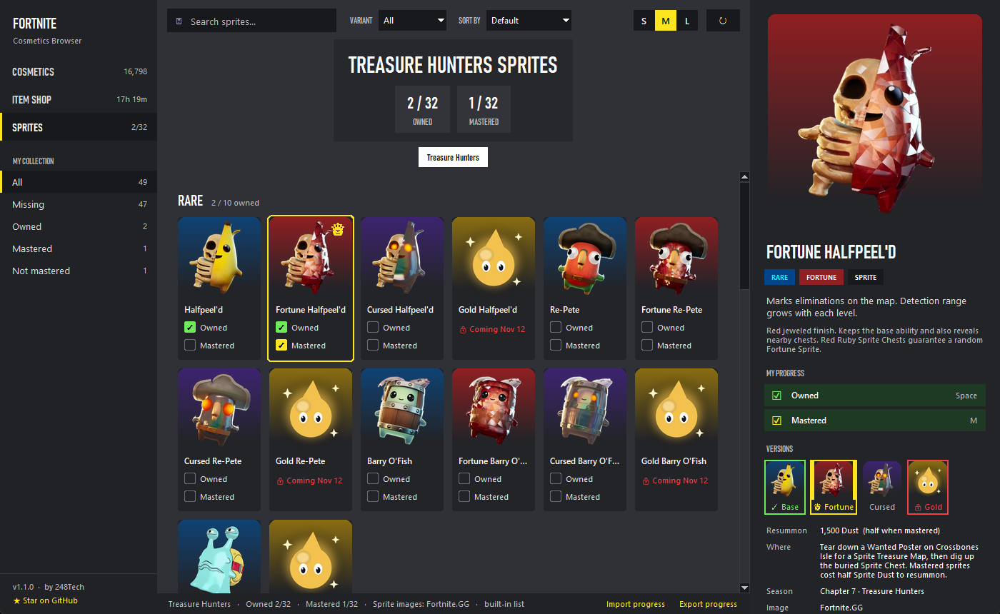
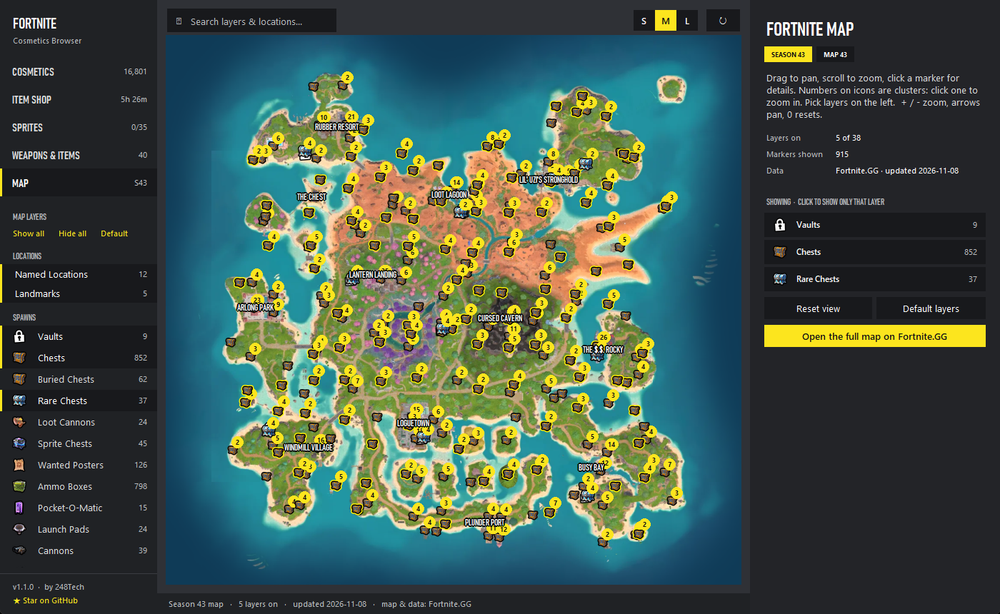
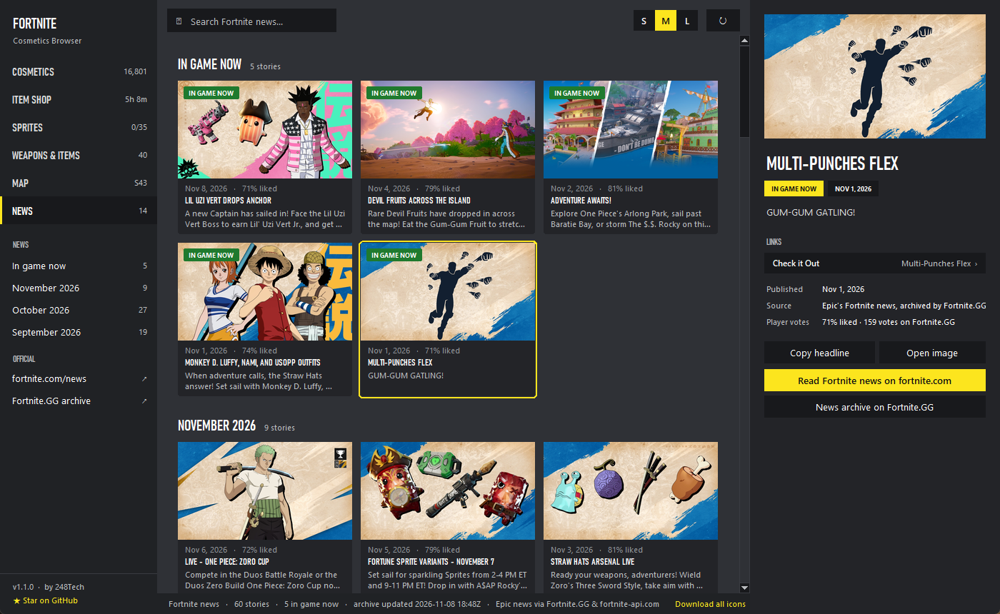
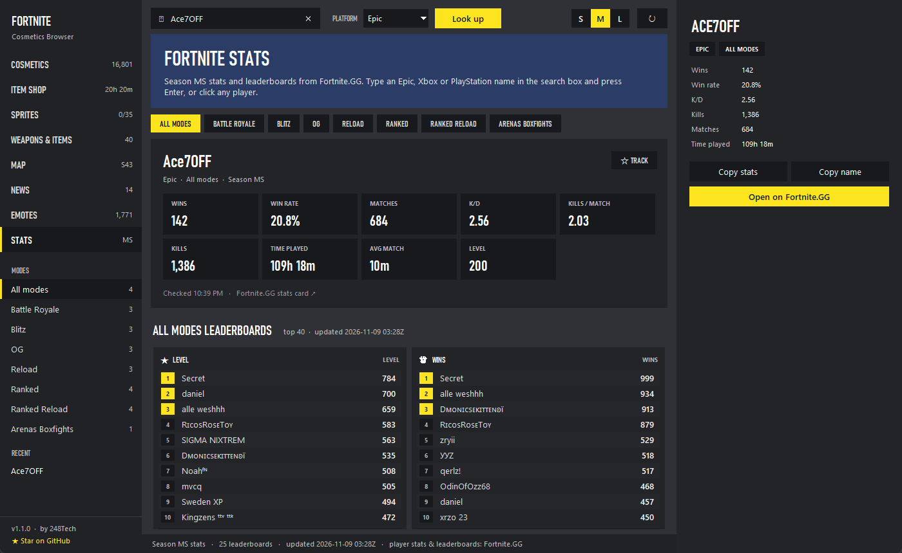
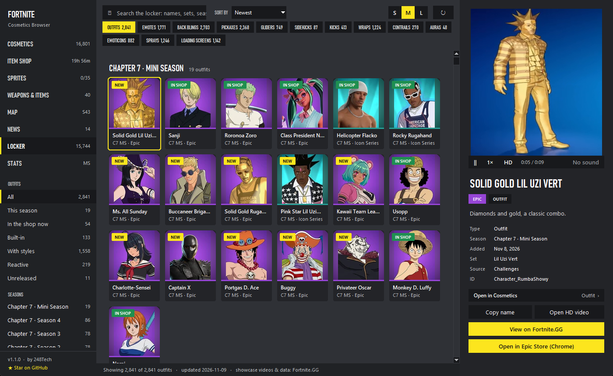

<div align="center">


# Fortnite Cosmetics Browser

**Every Fortnite cosmetic with its showcase video, today's Item Shop, player stats and a Sprite tracker in one fast, beautiful app.**
Search all 16,000+ skins, emotes, pickaxes, gliders, wraps and kicks, watch each one's in-game showcase, check today's shop with V-Bucks prices, look up any player's season stats, and jump straight to any item on fortnite.com. Free, open source, no login.

[](https://248tech.github.io/fortnite-cosmetics-browser/)
[](https://github.com/248Tech/fortnite-cosmetics-browser/releases/latest)


[](https://248tech.com)


</div>

## Why Fortnite Cosmetics Browser?

Looking up a Fortnite skin usually means ad-heavy sites, slow pages and endless scrolling. **Fortnite Cosmetics Browser is a clean, instant viewer for the whole Fortnite locker catalog and the daily Item Shop.**

- ⚡ **Instant search across 16,000+ cosmetics.** Filter by category and rarity, sort by newest, name or rarity, and scroll the whole catalog without lag.
- 🛒 **Today's Item Shop, live.** Every offer grouped into its shop section, with V-Bucks prices, discounts, "leaves in" timers and a countdown to the daily reset.
- 🏷️ **"In shop" badges everywhere.** Spot which cosmetics you can buy today, then jump from an item to its offer and from a bundle to every item inside it.
- ✨ **Sprite tracker.** Every Sprite and every Fortune, Cursed and Gold version as its own card with Owned and Mastered checkboxes, using official sprite images from [Fortnite.GG](https://fortnite.gg/sprites).
- 👑 **Player stats.** Look up any Epic, Xbox or PlayStation name for season wins, win rate, K/D, kills per match, time played and Ranked / Arena rank in 8 modes, track players, see progress since your last check, and browse 25 season leaderboards (data from [Fortnite.GG](https://fortnite.gg/stats)).
- 🎒 **Locker with showcase videos.** Every outfit, emote, back bling, pickaxe, glider, sidekick, kicks, wrap, contrail, aura, emoticon, spray and loading screen (15,700+) with its in-game showcase video: hover a card to preview (web), click to play in HD with sound, grouped by season with NEW / IN SHOP badges and per-type filters (showcase videos from [Fortnite.GG](https://fortnite.gg/cosmetics)).
- 📰 **Fortnite news.** Epic's official news posts with images, what's in game right now, links straight to the featured cosmetics, grouped by month and searchable (archive from [Fortnite.GG](https://fortnite.gg/news) refreshed every 3 hours, plus Epic's live in-game news).
- 🗺️ **Interactive map.** The current season's island with chests, rare chests, vaults, NPCs, vehicles, ziplines, fishing spots and 30+ more layers. Pan, zoom, search locations, click any marker for details (map, icons and data from [Fortnite.GG](https://fortnite.gg/), refreshed daily).
- 🔫 **Weapon & item stats.** The current loot pool with damage, DPS, fire rate, reload, recoil, falloff and spawn chances for every rarity, plus all 476 weapons ever (data from [Fortnite.GG](https://fortnite.gg/weapons), refreshed daily).
- 🔗 **One click to fortnite.com.** "Open in Epic Store" takes you straight to the item's official page on fortnite.com.
- 💾 **Offline icon cache (desktop).** Icons are cached as tiny thumbnails, so the app gets faster every time you use it. One click downloads them all.
- 🔒 **No account, no tracking.** No Epic login, no telemetry. Data comes from the public [fortnite-api.com](https://fortnite-api.com).
- 🌐 **Runs anywhere.** Use the [live web demo](https://248tech.github.io/fortnite-cosmetics-browser/) on any device, or grab the native Windows app.

## 🛒 Today's Item Shop


- Every offer in today's shop, grouped by its in-game section (bundles, featured sets, Jam Tracks, cars and more)
- Final and regular V-Bucks price, savings, discount banners and exactly when each offer leaves
- Sidebar section list to jump through the shop, plus a live countdown to the next reset
- Click any item inside a bundle to open it in the cosmetics browser

## ✨ Sprite tracker



- Every Sprite in the current season (Chapter 7 · Treasure Hunters) with its ability, rarity and resummon cost
- Every sprite **and every variant** (**Fortune**, **Cursed**, **Gold**) is its own card with **Owned** and **Mastered** checkboxes, laid out like Fortnite.GG
- Owned / Mastered counters, a Variant filter, sorting, and Missing / Owned / Mastered / Not mastered filters
- Upcoming sprites and variants show their release date
- Export your progress to JSON and import it on another PC or in the web demo

Epic has no public Sprite API, so the list lives in [`docs/data/sprites.json`](docs/data/sprites.json). Both apps download it from the website, so new sprites, variants and seasons appear without an update. Spot a missing sprite? Edit that file in a pull request. Sprite pictures come from **[Fortnite.GG](https://fortnite.gg/sprites)** (used with permission) and load at runtime; nothing is bundled. The Fortnite Wiki is a fallback for sprites without a Fortnite.GG name, and the app draws a stand-in for versions that aren't out yet. You can also use your own photos: select a sprite, screenshot it in-game (`Win+Shift+S`), press `Ctrl+V`, or choose a file (works for each variant too). Epic's own Sprite news art shows in the detail panel. On desktop you can also drop pictures into `%LOCALAPPDATA%\FortniteCosmeticsBrowser\sprite_images\` as `<id>.png` or `<id>_<variant>.png` (for example `wayfinder_fortune.png`).

## 🗺️ Interactive map



- Every layer from Fortnite.GG's map: chests (gold outline = 100% spawn), rare and buried chests, vaults, sprite chests, ammo boxes, vending machines, launch pads, cannons, cars, boats, ziplines, Port-a-Potty tunnels, campfires, slurp, fishing, reboot vans, extraction sites and every NPC.
- Turn layers on and off in the sidebar (your choice is remembered). Dense layers cluster with a count; click a cluster to zoom in.
- Search a location (`Enter` jumps there), click a marker for its layer, nearest named place and position, or use "Only this layer".
- Drag to pan, scroll or pinch to zoom, `+` / `-` / arrows / `0` on the keyboard. The web version updates the link (`#map/@x,y,zoom`) so you can share a view.

## 📰 Fortnite news



- The latest ~60 official Fortnite news posts (about two months) with art, date, text and player votes.
- **In game now** shows what Epic is running in the game today (live from Epic's news feed), so new stories appear before the archive refreshes.
- "Check it out" links open the featured cosmetic right in the app; tournament and island links open on Fortnite.GG.
- Why not scrape fortnite.com/news directly? It blocks all automated requests (Cloudflare) and its news API is switched off, so the app reads the same Epic posts from Fortnite.GG's archive and links to fortnite.com/news for the full site.

## 👑 Stats



- Type a player name in the search box and press `Enter` (pick Xbox or PlayStation for console names). Mode chips switch between All modes, Battle Royale, Blitz, OG, Reload, Ranked, Ranked Reload and Arenas Boxfights.
- Stat tiles: wins, win rate, matches, K/D, kills per match, kills, time played, average match length and level, plus the rank badge and progress to the next rank in Ranked and Arenas. Same formulas as Fortnite.GG's stats card.
- Every lookup is saved so the card shows **progress since your last check** (`+3 wins · +40 kills ...`) with a wins/kills trend line. **☆ Track** pins a player to the sidebar and the stats header; recent searches are listed too.
- Season leaderboards (top 40) for level, wins, kills, time and rank in every mode, refreshed every 3 hours. Click any name to look them up.
- Desktop saves this in `%LOCALAPPDATA%\FortniteCosmeticsBrowser\stats_players.json`, web in the browser.
- **Web demo note:** Fortnite.GG's stats API doesn't send a CORS header yet, so browsers block player lookups from this site. Leaderboards work, and the page links to the player on Fortnite.GG. Lookups work fully in the desktop app. Adding `Access-Control-Allow-Origin: https://248tech.github.io` to `fortnite.gg/stats…&ajax` responses would turn them on in the web demo with no code change.

## 🎒 Locker



- 13 types, each a chip at the top: **Outfits** (2,841), **Emotes** (1,771), **Back Blings**, **Pickaxes**, **Gliders**, **Sidekicks**, **Kicks**, **Wraps**, **Contrails**, **Auras**, **Emoticons**, **Sprays** and **Loading Screens**. Newest season first, with rarity, set, source, price and when it was last in the shop.
- **Showcase videos:** the web demo plays a muted preview when you hover a card; selecting an item plays its in-game showcase in the detail panel with play/pause, seek, `HD`, `0.5×` speed, sound and full screen. Sprays and loading screens show their full-size art instead. Items in the **Cosmetics** tab play their showcase too, with a jump to the Locker.
- Desktop plays the showcase right in the app (decoded with [PyAV](https://pyav.basswood-io.com/)) with its sound through Windows' built-in player, `HD`, `0.5×` slow motion and a remembered **Sound on/off** switch; clips that are silent show "No sound". Clips are cached in `%LOCALAPPDATA%\FortniteCosmeticsBrowser\clips\` (newest 150 kept).
- Filters adapt to the type: This season, In the shop now, Dances / Traversal / Synced (emotes), Built-in, With styles, Reactive, Animated, Unreleased. Sorts: newest, oldest, name, rarity. Web links: `#locker/<type>/<id>`.

## 🌐 Live web demo

**Try it now: [248tech.github.io/fortnite-cosmetics-browser](https://248tech.github.io/fortnite-cosmetics-browser/)**


The web version is a single static page with no build step and no dependencies. It works on desktop and mobile, supports shareable links (for example `#item/Character_CeleryStitch` or `#shop`), and runs the same search, filters, shop view and fortnite.com links as the desktop app.

## ⬇️ Download and install

### Windows app (recommended)

1. Download **`FortniteCosmeticsBrowser.exe`** from the [latest release](https://github.com/248Tech/fortnite-cosmetics-browser/releases/latest).
2. Double-click it. No installer, nothing else to set up.

> Windows SmartScreen may warn about an unrecognized app because the exe isn't code-signed. Click **More info → Run anyway**, or run it from source as shown below. Every release is built from this repo by [GitHub Actions](.github/workflows/release.yml).

### Run from source

Requires [Python 3.10+](https://www.python.org/downloads/).

```bash
git clone https://github.com/248Tech/fortnite-cosmetics-browser.git
cd fortnite-cosmetics-browser
pip install -r requirements.txt
python fortnite_cosmetics_browser.pyw
```

On Windows you can also double-click **`Launch Fortnite Cosmetics Browser.bat`**, which installs Pillow and PyAV if needed and starts the app without a console window.

### Build the exe yourself

```bash
pip install pillow av pyinstaller
pyinstaller --onefile --windowed --name FortniteCosmeticsBrowser --icon assets/icon.ico fortnite_cosmetics_browser.pyw
```

The exe lands in `dist/`.

## ⌨️ Keyboard shortcuts

| Action | Desktop | Web |
|---|---|---|
| Focus search | `Ctrl+F` | `/` or `Ctrl+F` |
| Clear search | `Esc` | `Esc` |
| Move selection | Arrow keys | Arrow keys |
| Open full image | `Enter` / double-click | `Enter` / double-click |
| Copy name / ID | Right-click a tile | Buttons in the detail panel |
| Switch Cosmetics / Shop / Sprites / Weapons / Map / News / Locker / Stats | `Ctrl+1` … `Ctrl+8` | Sidebar |
| Stats: look up the typed player | `Enter` in the search box | `Enter` in the search box |
| Locker: play / pause showcase | `Space` / `Enter` / double-click | `Space` (`Enter` opens Fortnite.GG) |
| Map: zoom / pan / reset | `+` `-` / arrows / `0` | same |
| Sprite card: Owned / Mastered | `Space` / `M` (or click the checkboxes) | `Space` / `M` (or click the checkboxes) |
| Refresh data | `F5` | Reload page |

## ✨ Features at a glance

| | Desktop (Windows) | Web demo |
|---|:---:|:---:|
| Search, category and rarity filters, 6 sort orders | ✅ | ✅ |
| Today's Item Shop with prices, discounts, timers | ✅ | ✅ |
| "In shop" badges and item ↔ offer navigation | ✅ | ✅ |
| Open items on fortnite.com | ✅ (in Chrome) | ✅ |
| Sprite tracker (Owned / Mastered per sprite and variant) + JSON backup | ✅ | ✅ (saved in the browser) |
| Weapon & item stats, falloff chart, spawn chances, all-weapons catalog | ✅ | ✅ |
| Interactive map with 38 toggleable layers, clusters, location search | ✅ | ✅ |
| Fortnite news (official posts, in game now, cosmetic links) | ✅ | ✅ |
| Locker: 13 cosmetic types with showcase videos (HD, speed, sound) | ✅ | ✅ (+ hover previews) |
| Player stats, tracking, progress, season leaderboards | ✅ | ✅ leaderboards (player lookups need Fortnite.GG CORS) |
| S / M / L tile sizes (remembered) | ✅ | ✅ |
| Shareable item links | | ✅ |
| Offline thumbnail cache + "download all icons" | ✅ | |
| Export the filtered list to CSV | ✅ | |
| Works when offline (last cached data) | ✅ | |

## 🔧 How it works

- **Data:** cosmetics come from [`/v2/cosmetics/br`](https://dash.fortnite-api.com/endpoints/cosmetics) and the shop from [`/v2/shop`](https://dash.fortnite-api.com/endpoints/shop) on fortnite-api.com, a free community API. No API key is needed.
- **Fast grid:** both versions draw only the tiles on screen (a virtualized grid), so scrolling 16,000+ items stays smooth.
- **Desktop cache:** the item list is cached for 12 hours and the shop is refreshed after each daily reset. Icons are stored as small resized WebP thumbnails in `%LOCALAPPDATA%\FortniteCosmeticsBrowser`, so the full set is only about 90 MB.
- **fortnite.com links:** item pages on fortnite.com use a short code derived from the item's internal ID. The app rebuilds those links locally (verified against real fortnite.com URLs) for outfits, emotes, wraps, kicks and contrails, and uses fortnite.com's own shop search for other item types.

### Project layout

```
fortnite_cosmetics_browser.pyw   Windows desktop app (Tkinter + Pillow, single file)
docs/                            Web demo, served by GitHub Pages
  index.html, style.css, app.js  No framework, no build step
  data/sprites.json              Sprite catalog (edit to add sprites, variants, seasons)
  data/weapons.json              Weapon & item stats (generated by tools/scrape_fortnitegg.py, refreshed daily)
  data/map.json                  Map layers and markers (generated by tools/scrape_fortnitegg.py, refreshed daily)
  data/news.json                 Fortnite news archive (generated by tools/scrape_fortnitegg.py, refreshed every 3 h)
  data/locker/                   index.json + one file per cosmetic type with Fortnite.GG clip ids (generated by tools/scrape_fortnitegg.py, refreshed daily)
  data/stats.json                Season leaderboards for every stats mode (generated by tools/scrape_fortnitegg.py, refreshed every 3 h)
  map.js                         Web map engine (canvas, no dependencies)
tools/scrape_fortnitegg.py       Scraper for weapon/item stats, the map, news, the locker and stats leaderboards (Fortnite.GG)
assets/icon.ico                  App icon for the exe
.github/workflows/               CI checks and the release build
```

## 🤝 Contributing

Bug reports, ideas and pull requests are welcome. See [CONTRIBUTING.md](CONTRIBUTING.md) to get started, and [open an issue](https://github.com/248Tech/fortnite-cosmetics-browser/issues/new/choose) if something looks wrong.

If this project is useful to you, **please ⭐ star the repo**. It helps other players find it.

## 📄 License and credits

- Code released under the [MIT License](LICENSE). © 2026 [248Tech](https://248tech.com).
- Visual style, sprite images, weapon/item stats, the map (tiles, icons, markers), the news archive, the locker showcase videos and player stats / leaderboards courtesy of [Fortnite.GG](https://fortnite.gg). News text and art are Epic Games'.
- Cosmetic data and images: [fortnite-api.com](https://fortnite-api.com).

> **Disclaimer:** Fortnite is a trademark of Epic Games, Inc. This project is not affiliated with, endorsed, sponsored or approved by Epic Games. All Fortnite names, images and other game assets belong to Epic Games, Inc.

<div align="center">

**Made by [248Tech](https://248tech.com)** · [Live demo](https://248tech.github.io/fortnite-cosmetics-browser/) · [Download](https://github.com/248Tech/fortnite-cosmetics-browser/releases/latest) · [Report a bug](https://github.com/248Tech/fortnite-cosmetics-browser/issues)

</div>
