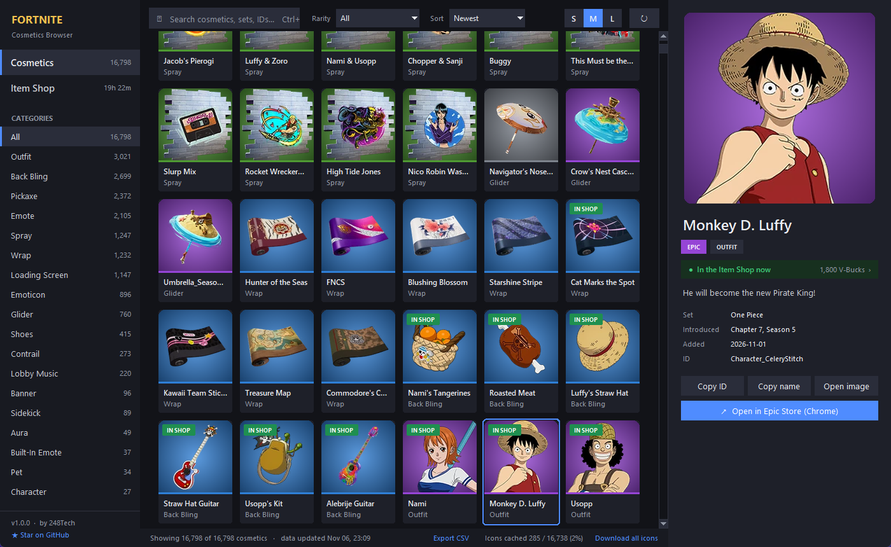
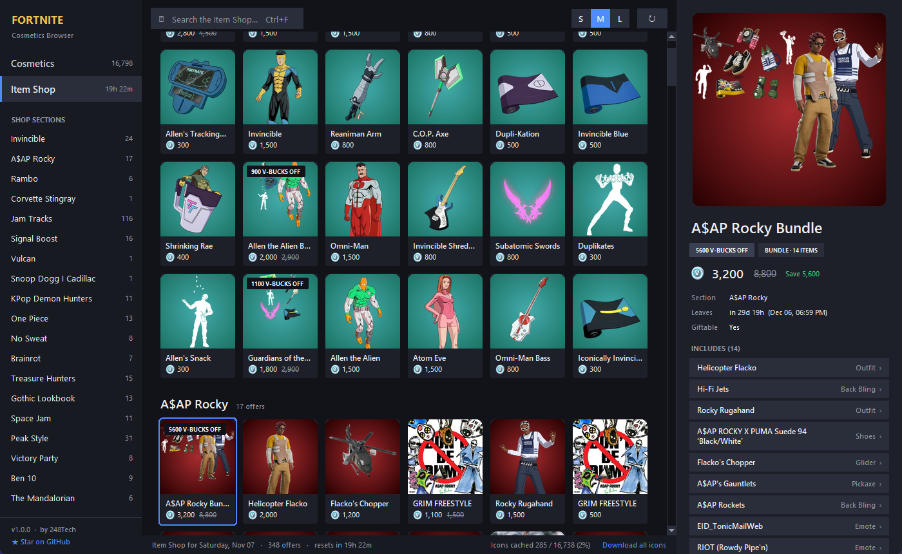
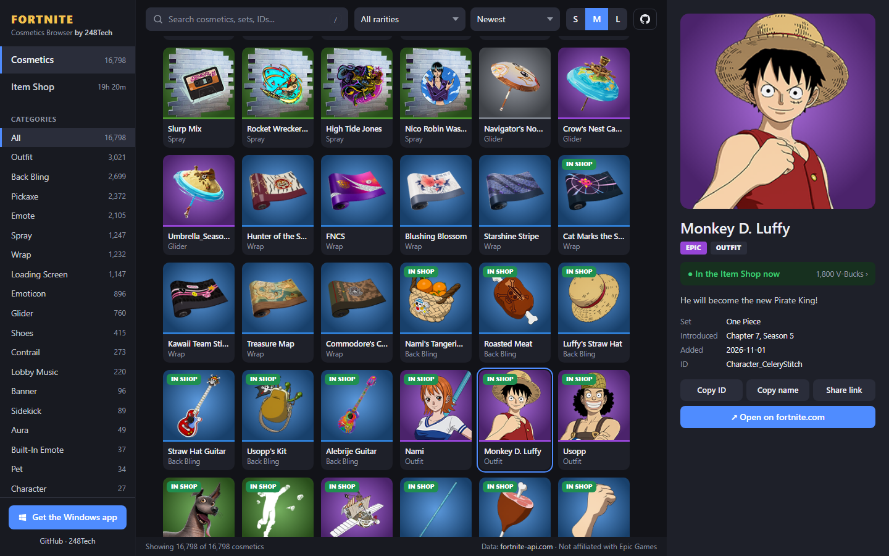

<div align="center">


# Fortnite Cosmetics Browser

**Every Fortnite cosmetic and today's Item Shop in one fast, beautiful app.**
Search all 16,000+ skins, emotes, pickaxes, gliders, wraps and kicks, check today's shop with V-Bucks prices, and jump straight to any item on fortnite.com. Free, open source, no login.

[](https://248tech.github.io/fortnite-cosmetics-browser/)
[](https://github.com/248Tech/fortnite-cosmetics-browser/releases/latest)


[](https://248tech.com)



</div>

## Why Fortnite Cosmetics Browser?

Looking up a Fortnite skin usually means ad-heavy sites, slow pages and endless scrolling. **Fortnite Cosmetics Browser is a clean, instant viewer for the whole Fortnite locker catalog and the daily Item Shop.**

- ⚡ **Instant search across 16,000+ cosmetics.** Filter by category and rarity, sort by newest, name or rarity, and scroll the whole catalog without lag.
- 🛒 **Today's Item Shop, live.** Every offer grouped into its shop section, with V-Bucks prices, discounts, "leaves in" timers and a countdown to the daily reset.
- 🏷️ **"In shop" badges everywhere.** Spot which cosmetics you can buy today, then jump from an item to its offer and from a bundle to every item inside it.
- 🔗 **One click to fortnite.com.** "Open in Epic Store" takes you straight to the item's official page on fortnite.com.
- 💾 **Offline icon cache (desktop).** Icons are cached as tiny thumbnails, so the app gets faster every time you use it. One click downloads them all.
- 🔒 **No account, no tracking.** No Epic login, no telemetry. Data comes from the public [fortnite-api.com](https://fortnite-api.com).
- 🌐 **Runs anywhere.** Use the [live web demo](https://248tech.github.io/fortnite-cosmetics-browser/) on any device, or grab the native Windows app.

## 🛒 Today's Item Shop



- Every offer in today's shop, grouped by its in-game section (bundles, featured sets, Jam Tracks, cars and more)
- Final and regular V-Bucks price, savings, discount banners and exactly when each offer leaves
- Sidebar section list to jump through the shop, plus a live countdown to the next reset
- Click any item inside a bundle to open it in the cosmetics browser

## 🌐 Live web demo

**Try it now: [248tech.github.io/fortnite-cosmetics-browser](https://248tech.github.io/fortnite-cosmetics-browser/)**



The web version is a single static page with no build step and no dependencies. It works on desktop and mobile, supports shareable links (for example `#item/Character_CeleryStitch` or `#shop`), and runs the same search, filters, shop view and fortnite.com links as the desktop app.

## ⬇️ Download and install

### Windows app (recommended)

1. Download **`FortniteCosmeticsBrowser.exe`** from the [latest release](https://github.com/248Tech/fortnite-cosmetics-browser/releases/latest).
2. Double-click it. No installer, nothing else to set up.

> Windows SmartScreen may warn about an unrecognized app because the exe isn't code-signed. Click **More info → Run anyway**, or run it from source as shown below. Every release is built from this repo by [GitHub Actions](.github/workflows/release.yml).

### Run from source

Requires [Python 3.10+](https://www.python.org/downloads/).

```bash
git clone https://github.com/248Tech/fortnite-cosmetics-browser.git
cd fortnite-cosmetics-browser
pip install -r requirements.txt
python fortnite_cosmetics_browser.pyw
```

On Windows you can also double-click **`Launch Fortnite Cosmetics Browser.bat`**, which installs Pillow if needed and starts the app without a console window.

### Build the exe yourself

```bash
pip install pillow pyinstaller
pyinstaller --onefile --windowed --name FortniteCosmeticsBrowser --icon assets/icon.ico fortnite_cosmetics_browser.pyw
```

The exe lands in `dist/`.

## ⌨️ Keyboard shortcuts

| Action | Desktop | Web |
|---|---|---|
| Focus search | `Ctrl+F` | `/` or `Ctrl+F` |
| Clear search | `Esc` | `Esc` |
| Move selection | Arrow keys | Arrow keys |
| Open full image | `Enter` / double-click | `Enter` / double-click |
| Copy name / ID | Right-click a tile | Buttons in the detail panel |
| Switch Cosmetics / Shop | `Ctrl+1` / `Ctrl+2` | Sidebar |
| Refresh data | `F5` | Reload page |

## ✨ Features at a glance

| | Desktop (Windows) | Web demo |
|---|:---:|:---:|
| Search, category and rarity filters, 6 sort orders | ✅ | ✅ |
| Today's Item Shop with prices, discounts, timers | ✅ | ✅ |
| "In shop" badges and item ↔ offer navigation | ✅ | ✅ |
| Open items on fortnite.com | ✅ (in Chrome) | ✅ |
| S / M / L tile sizes (remembered) | ✅ | ✅ |
| Shareable item links | | ✅ |
| Offline thumbnail cache + "download all icons" | ✅ | |
| Export the filtered list to CSV | ✅ | |
| Works when offline (last cached data) | ✅ | |

## 🔧 How it works

- **Data:** cosmetics come from [`/v2/cosmetics/br`](https://dash.fortnite-api.com/endpoints/cosmetics) and the shop from [`/v2/shop`](https://dash.fortnite-api.com/endpoints/shop) on fortnite-api.com, a free community API. No API key is needed.
- **Fast grid:** both versions draw only the tiles on screen (a virtualized grid), so scrolling 16,000+ items stays smooth.
- **Desktop cache:** the item list is cached for 12 hours and the shop is refreshed after each daily reset. Icons are stored as small resized WebP thumbnails in `%LOCALAPPDATA%\FortniteCosmeticsBrowser`, so the full set is only about 90 MB.
- **fortnite.com links:** item pages on fortnite.com use a short code derived from the item's internal ID. The app rebuilds those links locally (verified against real fortnite.com URLs) for outfits, emotes, wraps, kicks and contrails, and uses fortnite.com's own shop search for other item types.

### Project layout

```
fortnite_cosmetics_browser.pyw   Windows desktop app (Tkinter + Pillow, single file)
docs/                            Web demo, served by GitHub Pages
  index.html, style.css, app.js  No framework, no build step
assets/icon.ico                  App icon for the exe
.github/workflows/               CI checks and the release build
```

## 🤝 Contributing

Bug reports, ideas and pull requests are welcome. See [CONTRIBUTING.md](CONTRIBUTING.md) to get started, and [open an issue](https://github.com/248Tech/fortnite-cosmetics-browser/issues/new/choose) if something looks wrong.

If this project is useful to you, **please ⭐ star the repo**. It helps other players find it.

## 📄 License and credits

- Code released under the [MIT License](LICENSE). © 2026 [248Tech](https://248tech.com).
- Cosmetic data and images: [fortnite-api.com](https://fortnite-api.com).

> **Disclaimer:** Fortnite is a trademark of Epic Games, Inc. This project is not affiliated with, endorsed, sponsored or approved by Epic Games. All Fortnite names, images and other game assets belong to Epic Games, Inc.

<div align="center">

**Made by [248Tech](https://248tech.com)** · [Live demo](https://248tech.github.io/fortnite-cosmetics-browser/) · [Download](https://github.com/248Tech/fortnite-cosmetics-browser/releases/latest) · [Report a bug](https://github.com/248Tech/fortnite-cosmetics-browser/issues)

</div>
